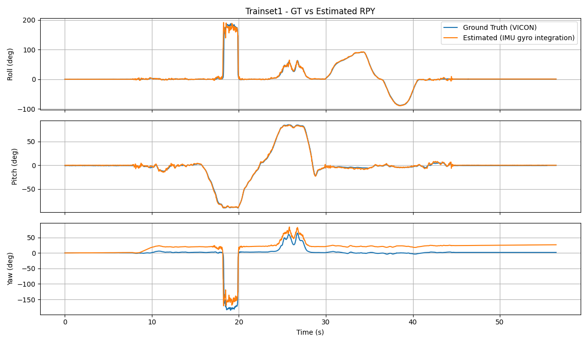
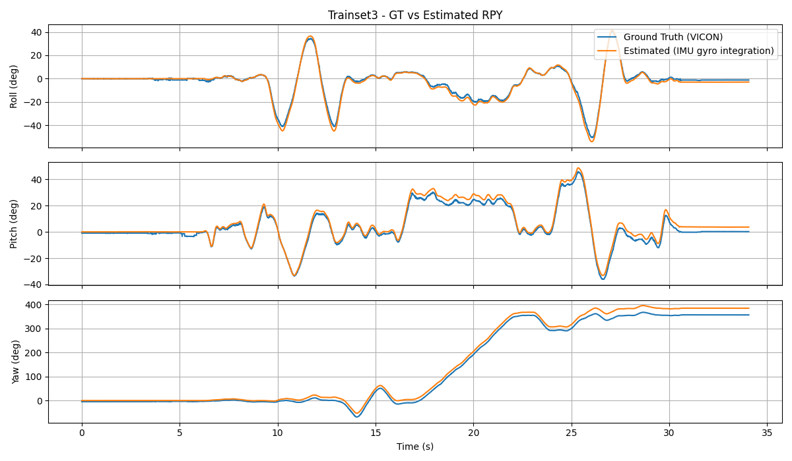
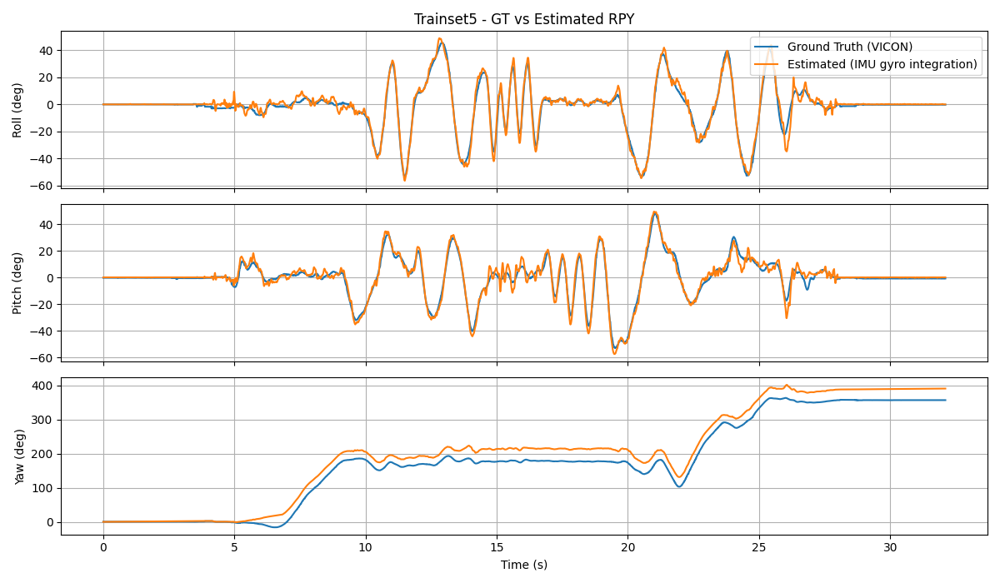
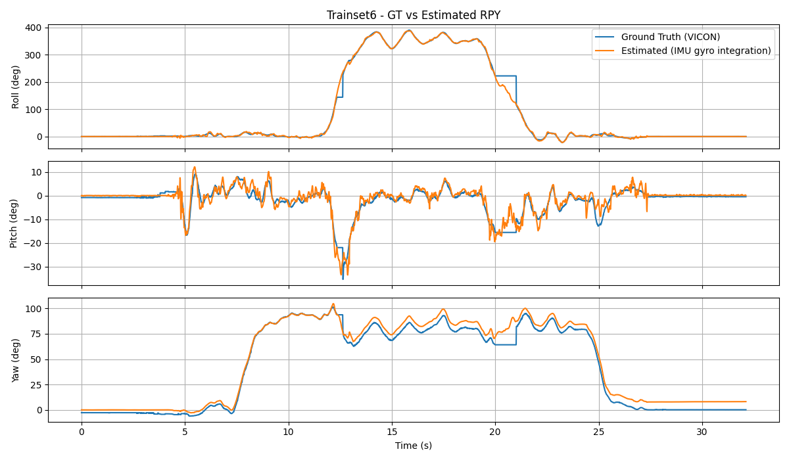
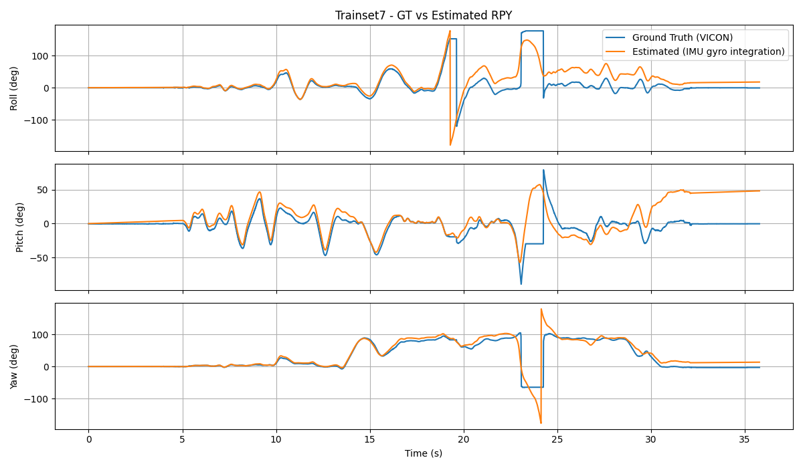
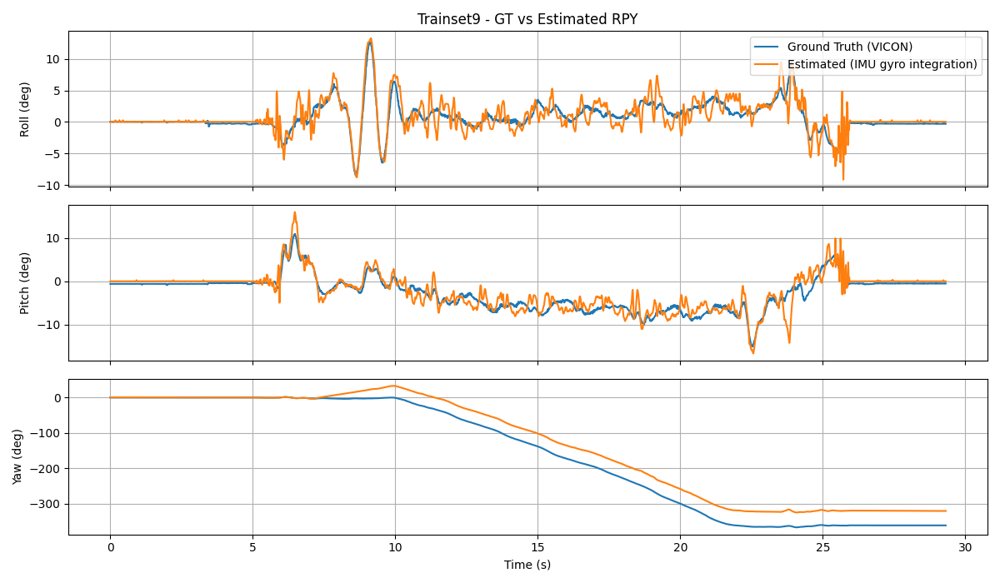
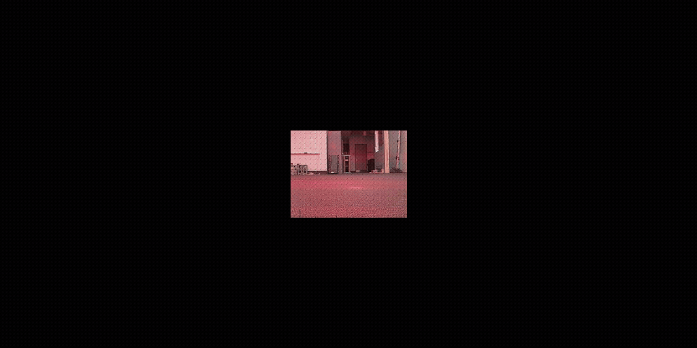
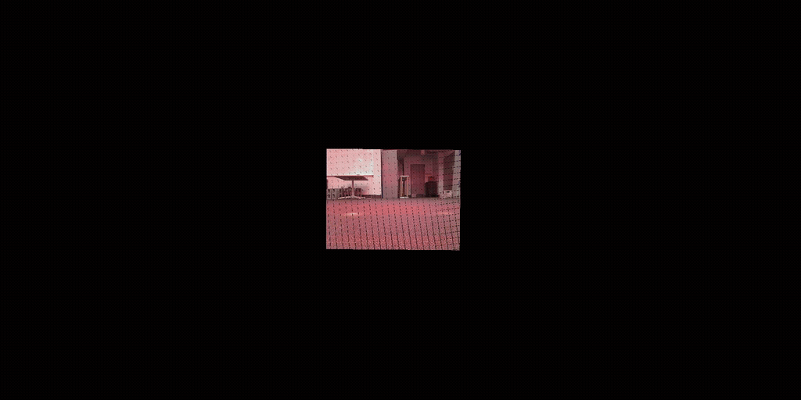
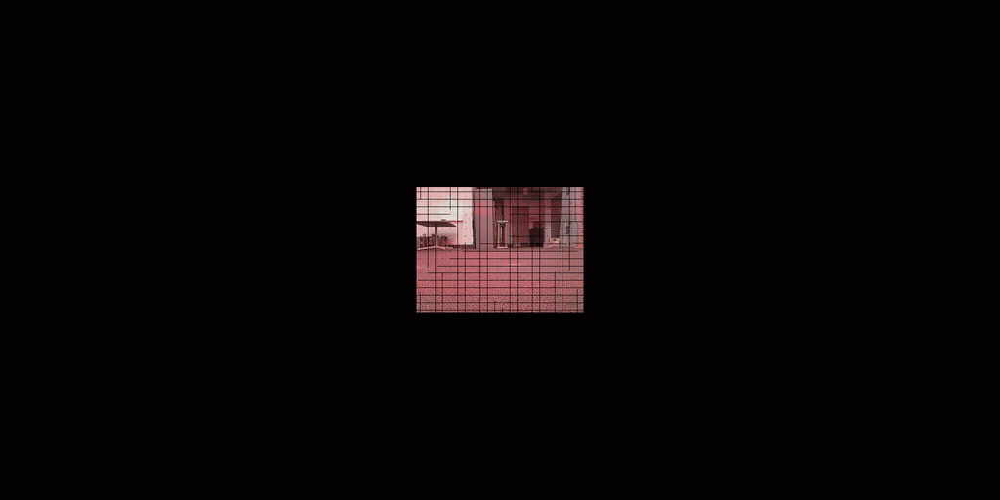

# Orientation Tracking

This project is part of ECE 276A: Sensing & Estimation in Robotics. It estimates device orientation from IMU accelerometer and gyroscope measurements, compares results with Vicon reference data, and includes tools for visualization and camera panorama generation.

## Project Structure

```text
.
├── Calibration.py       # IMU calibration, gyro integration, and orientation comparison
├── OrtTrack.py          # Quaternion trajectory optimization with motion and gravity losses
├── Panorama.py          # Panorama image and video generation from camera frames and rotations
├── Test.py              # Experimental script combining estimation and panorama generation
├── Utils/
│   ├── Load.py          # Dataset loading, timestamp alignment, and dataset selection
│   ├── Calibration.py   # Alternative IMU calibration and gyro integration implementation
│   ├── Loss.py          # Orientation estimation loss functions
│   ├── nQuat.py         # NumPy quaternion operations
│   └── tQuat.py         # PyTorch quaternion operations
├── Vis/                 # Plotting, animation, and video utilities
├── Given/               # Course-provided data loading and rotation plotting helpers
└── Output/              # Generated images, videos, and intermediate results
```

## Demo

### OrtTrack

| Dataset 1 | Dataset 3 | Dataset 5 |
|---|---|---|
|  |  |  |

| Dataset 6 | Dataset 7 | Dataset 9 |
|---|---|---|
|  |  |  |

### Panorama

| Dataset 1 | Dataset 8 | Dataset 10 |
|---|---|---|
|  |  |  |
## Requirements

Python 3.9 or later is recommended. Install the required packages with:

```bash
pip install numpy matplotlib opencv-python torch transforms3d
```

## Data Setup

The data loader expects the course dataset in a `data/` directory **one level above the project directory**:

```text
../data/
├── trainset/
│   ├── cam/cam{index}.p
│   ├── imu/imuRaw{index}.p
│   └── vicon/viconRot{index}.p
└── testset/
    ├── cam/cam{index}.p
    └── imu/imuRaw{index}.p
```

The files are pickle files provided with the course. Select a dataset by changing `trainset` in `Utils/Load.py`. Its current value is `10`, which selects the test set. Test data has no Vicon reference orientation. For workflows that compare against Vicon, select a training-set index (typically `1`–`9`). Camera data is loaded only for indices listed in the code: `1`, `2`, `8`, `9`, `10`, and `11`.

## Running the Scripts

Run commands from the project root so Python imports and relative data paths resolve correctly.

### IMU Calibration and Gyroscope Integration

```bash
python Calibration.py
```

This script estimates sensor biases from a stationary interval, converts accelerometer and gyroscope measurements to physical units, integrates angular velocity into a quaternion trajectory, and plots a comparison with Vicon when available.

### Orientation Trajectory Optimization

```bash
python OrtTrack.py
```

This script optimizes a quaternion trajectory using motion-continuity and gravity-direction observation losses. It saves `R_est{index}.npy` and plots Roll, Pitch, and Yaw against Vicon. This workflow requires a training set with Vicon data.

### Panorama Image and Video Generation

```bash
python Panorama.py
```

The current main script projects camera frames into a panorama using the Vicon rotations `R_v[idx_v2c]`, then writes a panorama image and a video of the stitching process. Although the script loads `R_est{index}.npy`, it does not currently use that estimate in the main workflow. Make sure the selected dataset has camera and Vicon data and that `Output/Panorama/{index}/` exists.

`Test.py` is an experimental combined script for orientation optimization and panorama generation. Check its dataset selection and input/output files before running it.

## Implementation Notes

- Quaternions use scalar-first ordering: `[w, x, y, z]`.
- Euler angles use the `sxyz` convention. Angular velocity is in rad/s, and calibrated accelerometer measurements are in g.
- Optimization settings such as learning rate and iteration count are currently defined directly in `OrtTrack.py`.
- `Utils/Load.py` loads the selected dataset at import time. Prepare the required data files and run scripts from the project root.
- Some workflows require Vicon or camera data and are not available for every test-set dataset.


