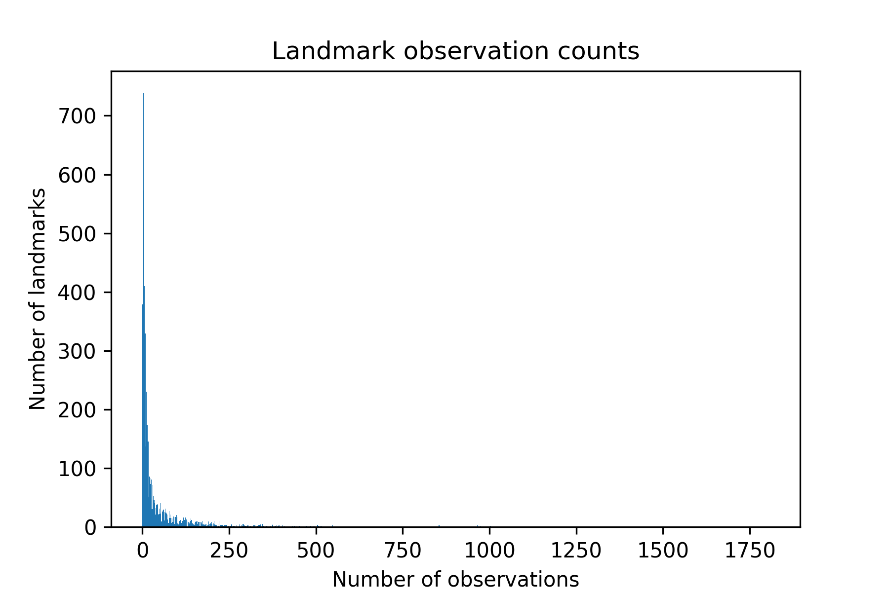
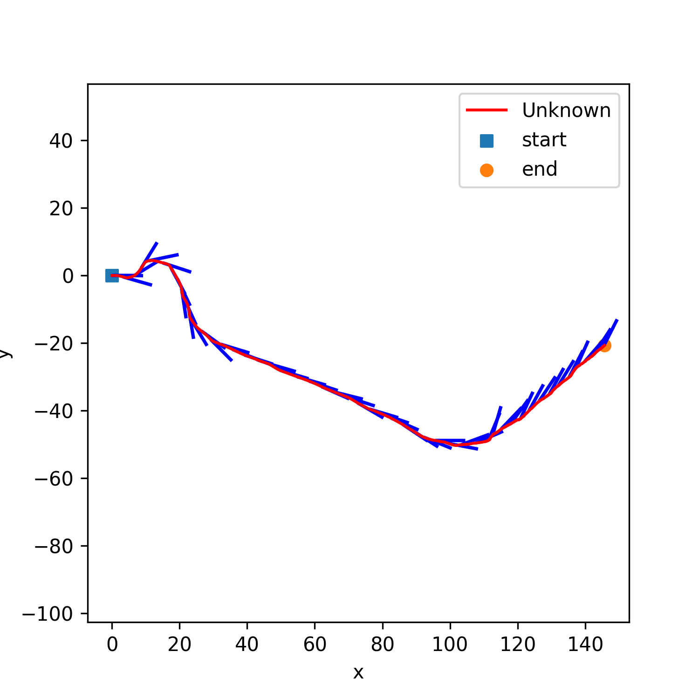
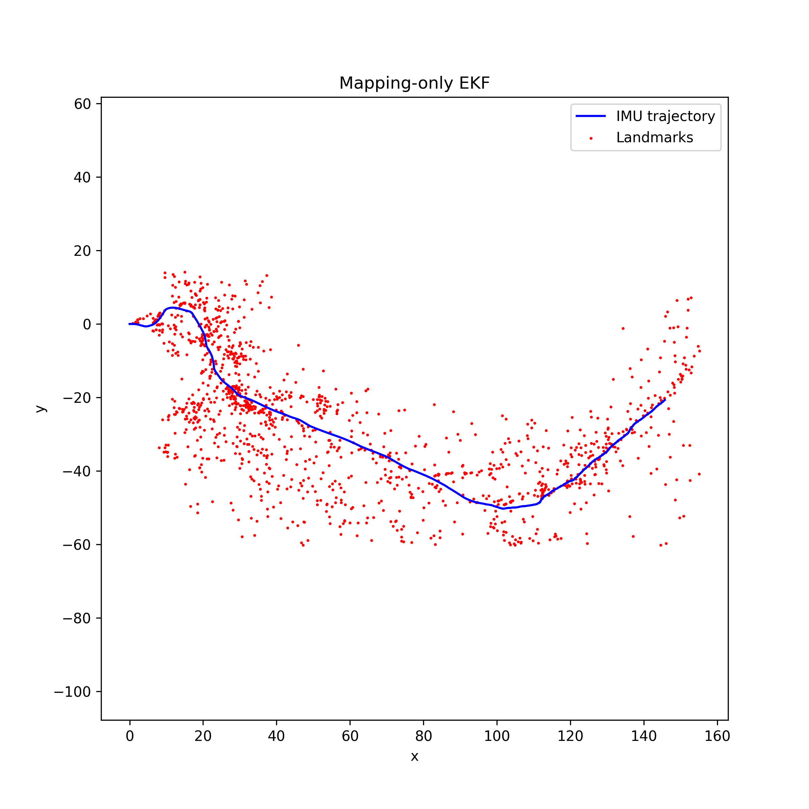
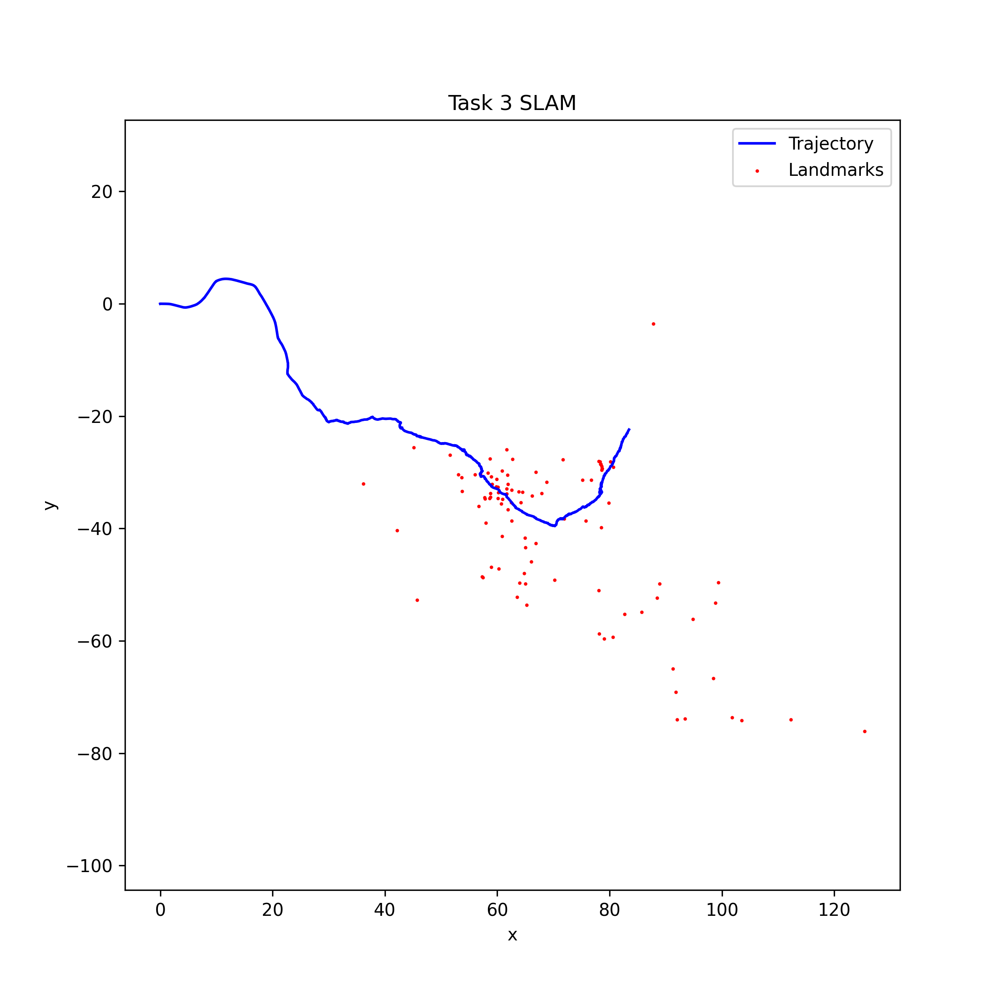
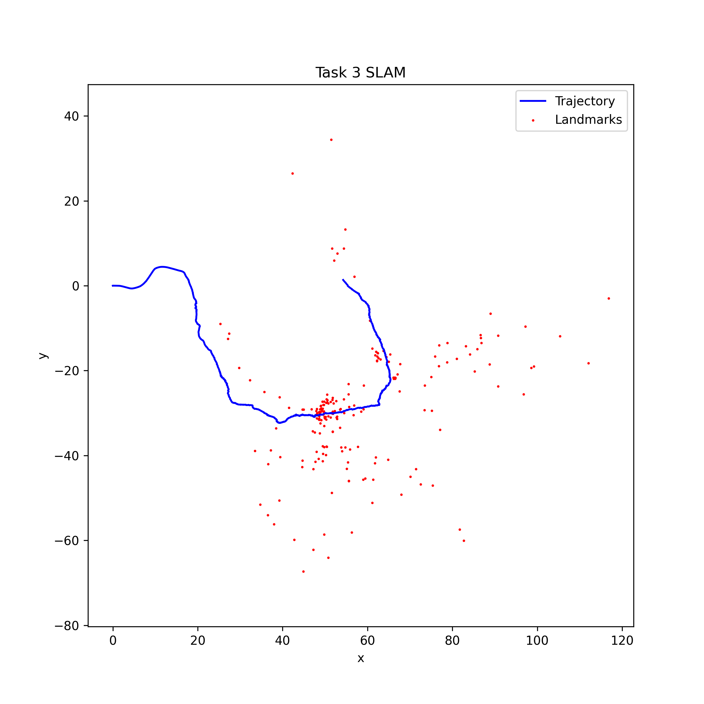
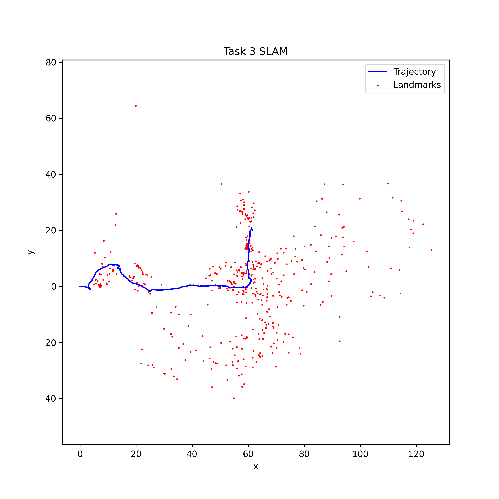
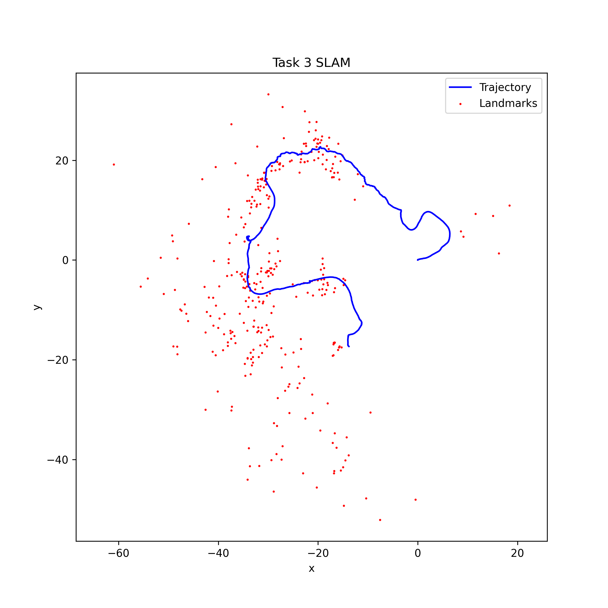

# ECE276A PR3 — Visual-Inertial SLAM

UCSD *Sensing & Estimation in Robotics*, Project 3.  
IMU odometry and stereo visual features with an EKF for trajectory estimation, landmark mapping, and visual-inertial SLAM.

for more information, please refer to `Report.pdf`
## Tasks

| Task | Description | Script |
|------|-------------|--------|
| 1 | IMU EKF prediction (dead reckoning) | `Scripts/Task/Task1.py` |
| 2 | Landmark mapping EKF with known poses | `Scripts/Task/Task2.py` |
| 3 | Joint pose + landmark visual-inertial SLAM | `Scripts/Task/Task3.py` |
| 4 | Object-oriented SLAM (`Robot` / `OdometryEKF` / `MappingEKF`) | `Scripts/Task/Task4.py` |

## Result
### Landmark Filter


I pick the most observed 500 landmarks to do Visual Inertial SLAM.
### Stereo Camera


| Marked Left | Marked Right |
| --- | --- |
|  |  |
| Reprojected Left | Reprojected Right |
|  |  |

To make sure I did a correct job in reconstructing, I visualize 3D points in camera frame and reproject it into camera frame. I drop some points if it is to close or too far from camera.
Reconstructed marks match pretty well with the original marks, which means I did a good job in reconstructing.
### Visual Inertial SLAM
Dataset 00

| Task1 | Task2 |
| --- | --- |
|  |  |
| Task3 with 100 landmarks | Task3 with 200 landmarks |
|  |  |
| Task3 with 500 landmarks | |
|  | |

Dataset 01

| Task1 | Task2 |
| --- | --- |
|  |  |
| Task3 with 500 landmarks | |
|  | |

## Dependencies

- Python 3
- `numpy`
- `matplotlib`
- `transforms3d`

```bash
pip install numpy matplotlib transforms3d
```

## Data & Configuration

Place the course datasets locally and set paths in `src/Config.py`:

```python
data_dir = r"/path/to/ECE276A/PR3"   # contains dataset01/, dataset02/, ...
dataset_id = 1                       # dataset index
out_dir = "Output"                   # output directory
```

Expected data files:

```
{data_dir}/dataset{id:02d}/dataset{id:02d}.npy
{data_dir}/dataset{id:02d}/dataset{id:02d}_imgs.npy   # optional, for image visualization
```

Each `.npy` file contains:

- `v_t`, `w_t`: IMU linear / angular velocity
- `timestamps`: timestamps
- `features`: stereo feature pixel coordinates `(4, n, t)`
- `K_l`, `K_r`: left / right camera intrinsics
- `extL_T_imu`, `extR_T_imu`: IMU → camera extrinsics

## How to Run

Set `PYTHONPATH` to `src/`. Use the existing VS Code / Cursor launch config, or run from the terminal:

```bash
cd "/path/to/PR3"
export PYTHONPATH="$(pwd)/src"

python Scripts/Task/Task1.py   # writes Output/task1.npz and trajectory plot
python Scripts/Task/Task2.py   # requires Task1 wTi
python Scripts/Task/Task3.py   # joint SLAM → Output/task3.npz and map
python Scripts/Task/Task4.py   # modular SLAM implementation
```

Run order: Task1 → Task2 (Task2 loads `Output/task1.npz`). Task3 and Task4 can run independently.

## Project Layout

```
PR3/
├── Scripts/
│   ├── Task/          # Task1–4 entry scripts
│   └── Test/          # camera reprojection, landmark filtering tests
├── src/
│   ├── Config.py      # paths and noise hyperparameters
│   ├── Robot.py       # robot / camera pose state
│   ├── EKF_odom.py    # IMU odometry prediction
│   ├── MappingEKF.py  # Task2 mapping EKF
│   ├── EKF/
│   │   ├── Odometry.py
│   │   └── Mapping.py
│   ├── Camera/        # stereo camera model and projection Jacobians
│   ├── Geometric/     # SO(3) / SE(3) utilities
│   └── Utils/         # data loading, visualization, landmark selection
├── Output/            # trajectories, maps, .npz results
├── Pics/              # figures used in Result section
└── Record/            # experiment figures
```

## Method Summary

1. **Odometry (Task1)**  
   Discrete \(SE(3)\) prediction from IMU \(v, \omega\); covariance propagated via the Adjoint.

2. **Mapping (Task2)**  
   Fixed trajectory; initialize and update 3D landmarks from stereo observations. Observation noise and prior variances are set in the script / `Config`.

3. **SLAM (Task3 / Task4)**  
   State dimension \(6 + 3M\) (pose perturbation + \(M\) landmarks). Each step: IMU predict → stereo update (analytic Jacobians). Pose is updated by left multiplication on the manifold; landmarks are updated in Euclidean space.

Tunable parameters (see `src/Config.py` and Task scripts):

- `sigma_v`, `sigma_w`: IMU process noise
- `obs_noise`: pixel observation noise
- `init_var_xy`, `init_var_z`: landmark initialization variance
- `min_obs`, `max_landmarks`: landmark filtering (min observations / cap)

## Outputs

Results are written to `Output/` by default:

- `task1.npz`: predicted trajectory `wTi` and covariance
- `task3.npz`: SLAM trajectory, map, and covariance
- `*.png`: 2D trajectory / map plots