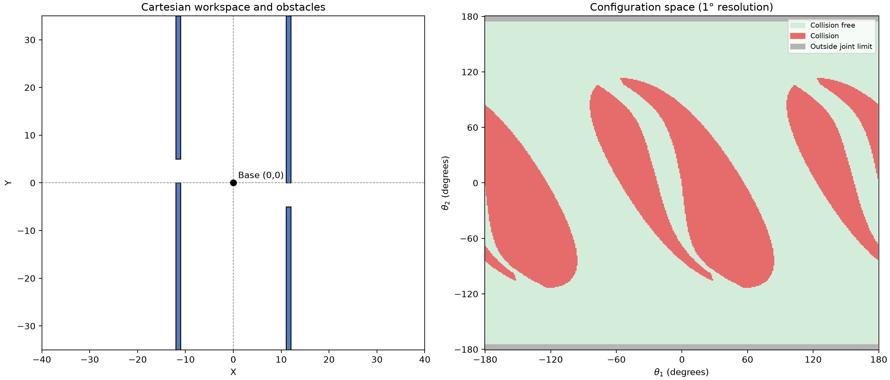
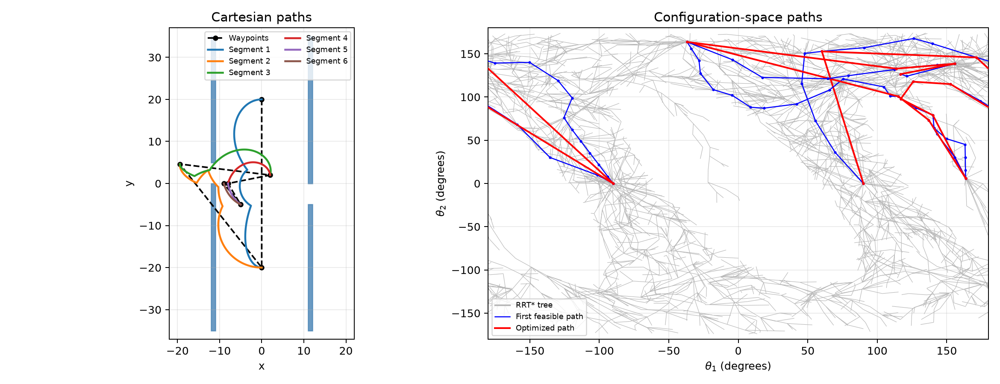
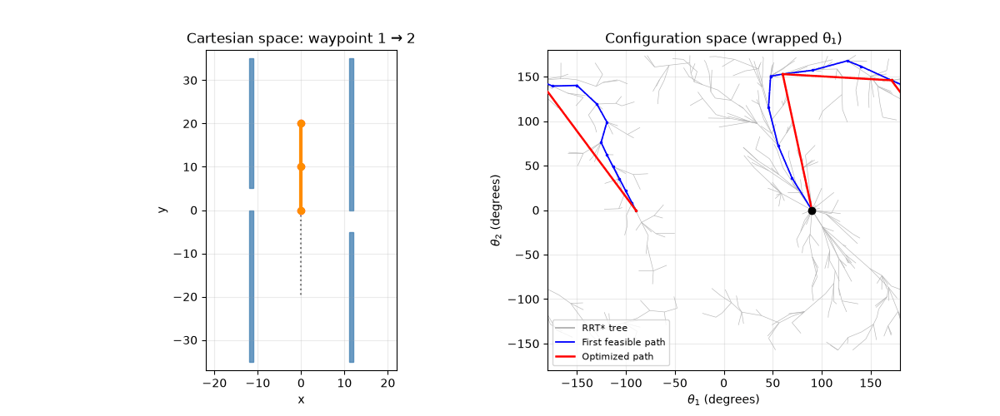
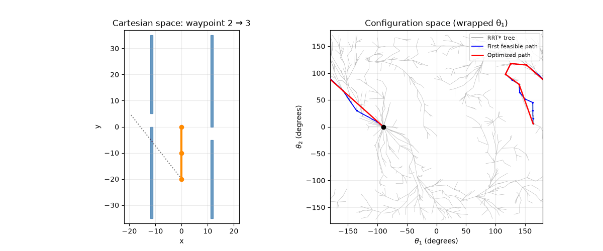

# ECE 276C Assignment 2: Configuration Space and Motion Planning

This project studies configuration-space analysis and RRT* motion planning for a planar two-degree-of-freedom (2R) robot arm. Both links are 10 units long. The rectangular obstacles and the second-joint limit are defined under `src/init_task/`.

## Features

- **Task 1: Configuration-space scan** — Sweeps joint angles at 1° resolution, classifies configurations as collision-free, in collision, or outside the second-joint limit, and plots the workspace and configuration space.
- **Task 2: RRT* motion planning** — Computes inverse-kinematics candidates for predefined Cartesian waypoints, plans collision-free paths between consecutive waypoints in configuration space, smooths paths with shortcutting, and creates an overview plot and segment animations.

Angles are represented internally in radians. The first joint is periodic, while the second joint is limited to `±0.97π`. Edge validity is checked by sampling points along each edge.

## Project structure

```text
.
├── asset/                  # Robot URDF files
├── output/
│   ├── task1/              # Configuration-space results and plots
│   └── task2/              # Paths, summary, overview plot, and segment GIFs
├── scripts/
│   ├── task1/main.py       # Task 1 entry point
│   ├── task1/plot.py
│   ├── task2/main.py       # Task 2 entry point
│   └── task2/plot.py
└── src/
    ├── RRTStar.py          # RRT* planner
    ├── path_utils.py       # Path densification and smoothing utilities
    ├── aspace.py           # Periodic joint-angle space utilities
    └── init_task/          # Robot, obstacle, and space definitions
```

## Demo

### Configuration space



### Planned paths



### Segment animations

#### Waypoint 1 to 2



#### Waypoint 2 to 3



## Requirements

Python 3 and the following packages are required:

```powershell
python -m pip install numpy matplotlib tqdm roboticstoolbox-python spatialgeometry spatialmath-python pillow
```

Run commands from the project root and add `src` to the Python module search path. The data paths in `src/Pathes.py` currently use this project's absolute path. If you move the project, update `Pathes.wsf` to the new project root first.

## Run

From the project root in PowerShell, run Task 1 with:

```powershell
$env:PYTHONPATH = "$PWD\src"
python scripts\task1\main.py
```

Task 1 scans the grid, saves `output/task1/cspace.npz`, and writes `output/task1/configuration_space.png`. The full scan evaluates about 130,000 angle combinations; runtime depends on your computer.

Run Task 2 with:

```powershell
$env:PYTHONPATH = "$PWD\src"
python scripts\task2\main.py
```

Task 2 plans six paths between consecutive waypoints. The planner and waypoints are configured in `src/RRTStar.py` and `scripts/task2/main.py`. The run creates or overwrites `output/task2/summary.txt`, `paths.npz`, `path_overview.png`, and the segment GIFs under `segment/`. The program exits with an error if it cannot find a path for a segment within its iteration limit.

## Outputs

- `output/task1/configuration_space.png` — Workspace obstacles and configuration-space occupancy plot.
- `output/task1/cspace.npz` — Grid angles and occupancy values: `0` (collision-free), `1` (collision), and `2` (outside the joint limit).
- `output/task2/path_overview.png` — Cartesian paths and the RRT* tree, initial paths, and smoothed paths in configuration space.
- `output/task2/segment/*.gif` — Robot motion animations for each pair of consecutive waypoints.
- `output/task2/summary.txt` — Waypoint and segment counts, path node counts, and joint-space path lengths.
- `output/task2/paths.npz` — Numeric paths and planner tree data. Load its object arrays with `numpy.load(..., allow_pickle=True)`.

## Notes

`asset/planar_two_link.urdf` is the planar two-link model used for collision checking; `asset/three_link_arm.urdf` is the source model. The script `scripts/make_planar_urdf.py` can generate the planar model.
