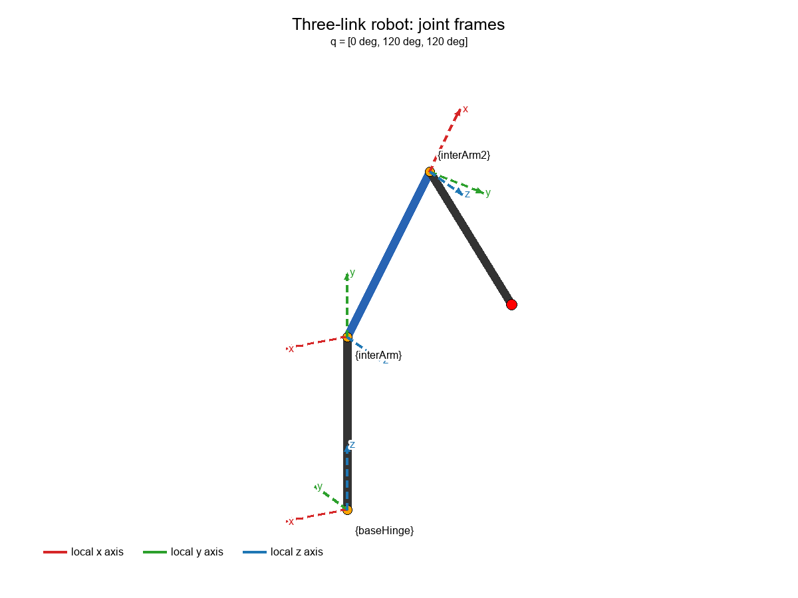
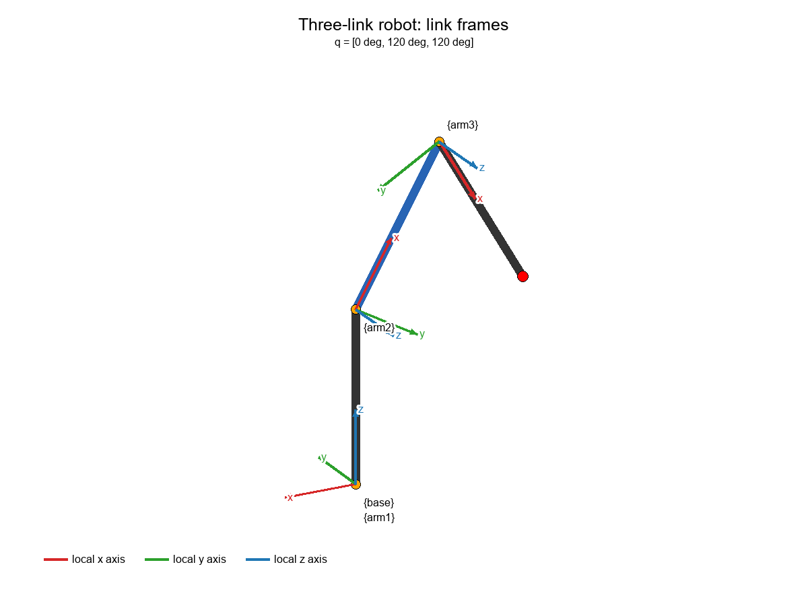
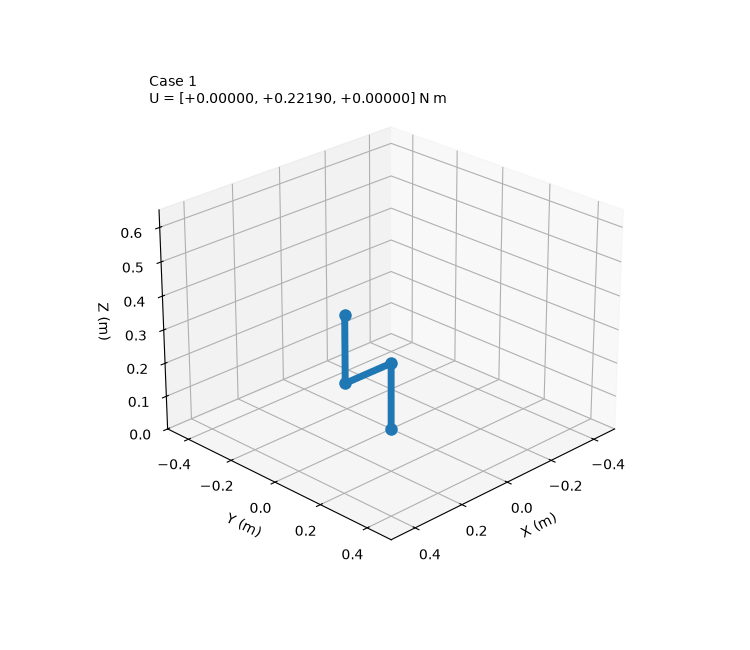
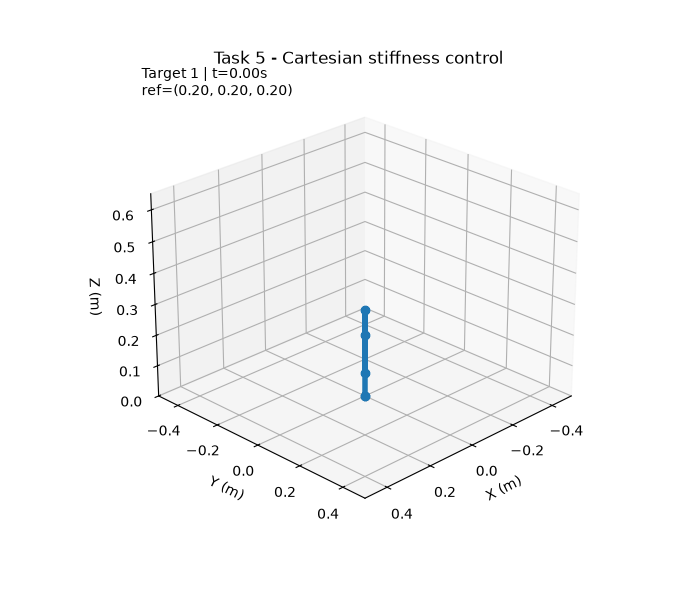
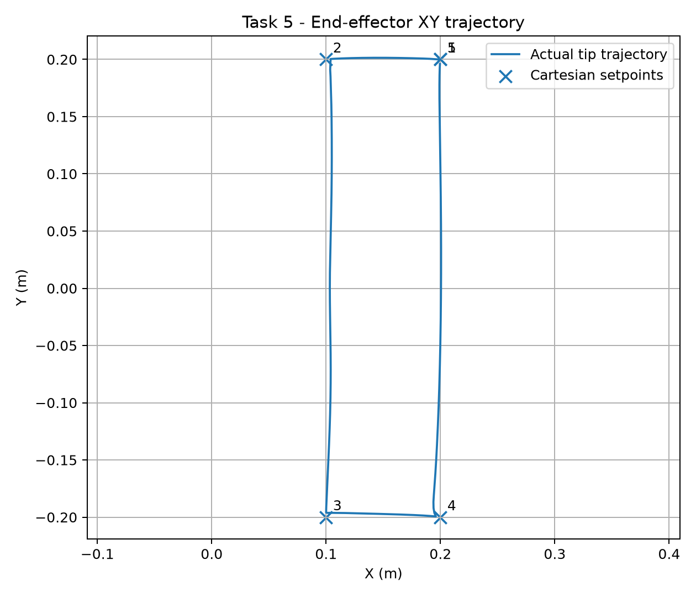
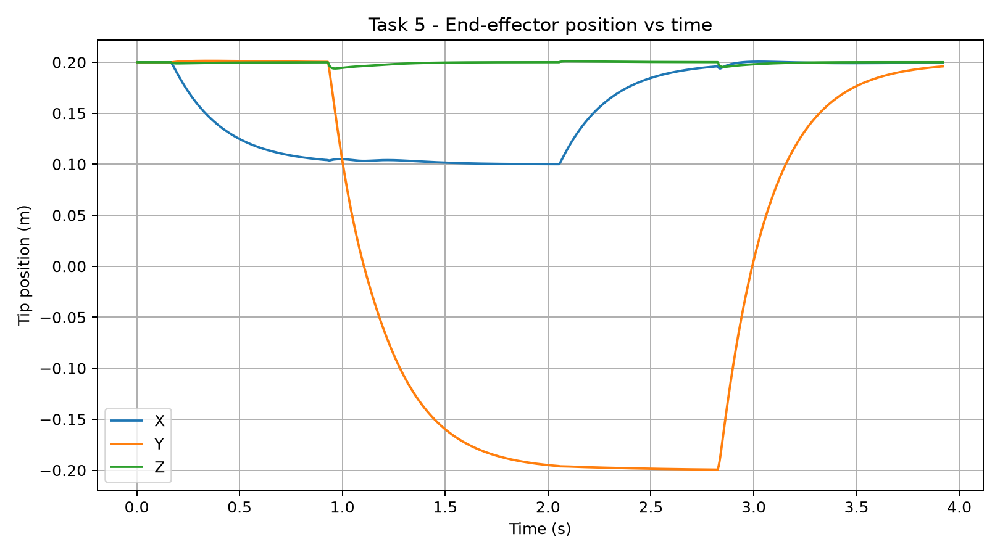
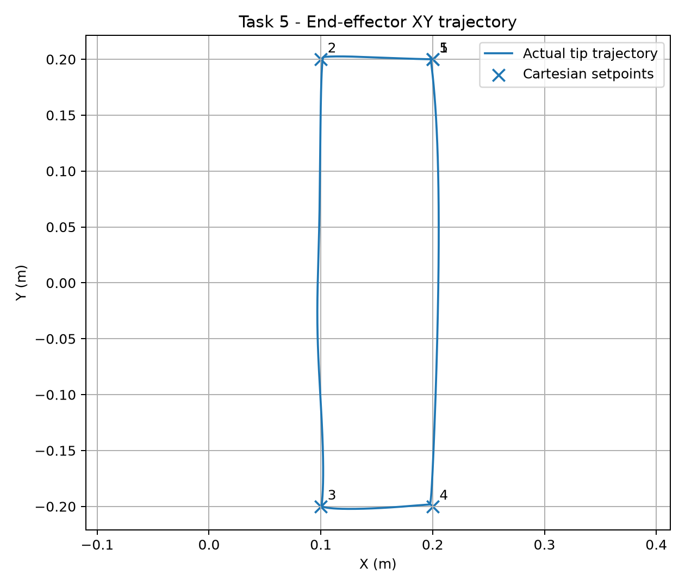
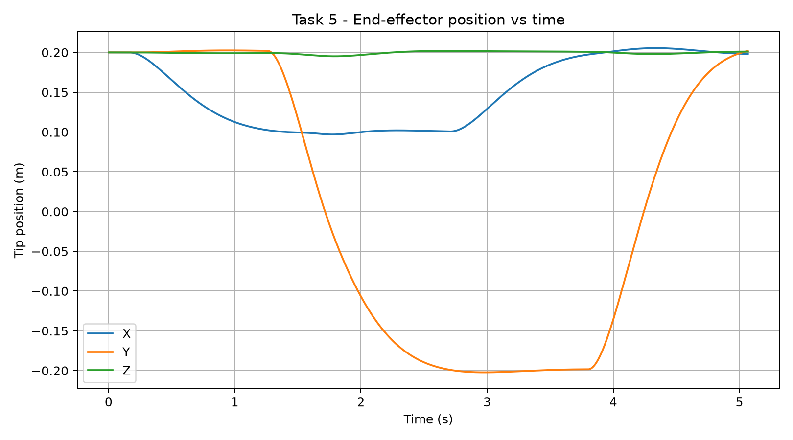

# ECE 276C - Assignment 3: Dynamics and Force Control

Code and deliverables for the **Dynamics and Force Control** assignment. The project models a 3-DOF, three-link robot, derives its rigid-body dynamics with SymPy, and simulates gravity compensation and Cartesian stiffness control with PyBullet.

## Project structure

```text
asset/                  Robot URDF models, with and without the payload
config/                 Robot, Task 4, and Task 5 configuration
src/Pathes.py           Project paths used by the scripts
src/robot/sympy/        Symbolic kinematics and Euler-Lagrange dynamics
src/robot/pybullet/     PyBullet model, state helpers, and simulation setup
scripts/Task2.py        Prints dynamics for the three requested states
scripts/Task4/          Static gravity-compensation simulations
scripts/Task5/          Cartesian stiffness-control simulation and plots
scripts/visualize_robot_frames.py
output/                 Generated figures, animations, and saved results
```
## Demo
### Frames
| Joint frames | Link frames |
|:---:|:---:|
|  |  |

The demonstrations below use the **analytical** controller/results only.

### Task 4 - Static hold

<table>
<tr><th>Without payload</th><th>With 3 kg payload</th></tr>
<tr>
<td></td>
<td></td>
</tr>
</table>

### Task 5 - Cartesian stiffness control

<table>
<tr><th>Without payload</th><th>With 3 kg payload</th></tr>
<tr>
<td>
<p><strong>Robot motion</strong></p>

<p><strong>End-effector XY trajectory</strong></p>

<p><strong>End-effector position over time</strong></p>

</td>
<td>
<p><strong>Robot motion</strong></p>

<p><strong>End-effector XY trajectory</strong></p>

<p><strong>End-effector position over time</strong></p>

</td>
</tr>
</table>

## Robot model

The robot has three revolute joints (`baseHinge`, `interArm`, `interArm2`) and three cylindrical links. The symbolic model uses density `300 kg/m^3`, link radius `0.02 m`, link length `0.2 m`, and gravity `9.81 m/s^2`. Joint friction is ignored in the assignment dynamics. The PyBullet simulation uses a fixed base and a 240 Hz time step.

`config/robot.yaml` selects the robot URDF:

- `payload: false` loads `asset/three_link_modified.urdf`.
- `payload: true` loads `asset/three_link_payload.urdf`, which includes a 3 kg point payload.

The symbolic model and gravity-compensation functions also read this setting. For Tasks 2-5 without the payload, leave this value `false`. Set it to `true` for the payload simulation in Task 6 (and the optional payload version of Task 4).

## Setup

Use Python 3.10 or newer. Install the project dependencies in a virtual environment:

```powershell
python -m venv .venv
.\.venv\Scripts\Activate.ps1
python -m pip install numpy sympy pybullet omegaconf matplotlib pillow
```

The scripts import modules from `src`. In PowerShell, set `PYTHONPATH` for the current terminal before running them:

```powershell
$env:PYTHONPATH = "$PWD\src"
```

`src/Pathes.py` currently points to the original project directory (`E:\ProjectLocal\ECE 276C\Assignment 3`). If you move or clone this project elsewhere, update `Pathes.wsf` to the new project root before running the scripts.

## Running the tasks

Run commands from the project root unless a command changes directory.

### Task 2: dynamics at the requested states

```powershell
python scripts\Task2.py
```

The script evaluates and prints `D(q)`, `C(q, qdot)`, and `G(q)` for the three configurations and velocities in the assignment. It also checks that each evaluated inertia matrix is symmetric and positive definite.

### Task 4: gravity compensation / static hold

```powershell
Push-Location scripts\Task4
python main.py
Pop-Location
```

This runs the analytical and finite-difference gravity-torque implementations for the three specified poses. GIF results are saved under `output/Task4/`.

For the optional 3 kg payload case, set `payload: true` in `config/robot.yaml`, then run:

```powershell
Push-Location scripts\Task4
python payload.py
Pop-Location
```

The payload results are saved under `output/Task4/payload/`. Restore `payload: false` when returning to the unloaded model.

The 3 kg payload URDF and payload-aware gravity/controller configuration are also available for Task 6. This repository does not currently have a separate Task 6 runner; the existing Task 5 runner can be used as the starting point for the payload trajectory simulation, with its duration and output path adjusted for that task.

### Task 5: Cartesian stiffness control

```powershell
Push-Location scripts\Task5
python main.py
Pop-Location
```

The controller uses a Cartesian spring-damper force and maps it into joint torques:

```text
e       = x_ref - x
xdot    = J(q) qdot
F       = Kp e - Kd xdot
tau     = J(q)^T F + G(q) - B qdot
```

It sends each waypoint directly as a setpoint (no path interpolation), compensates gravity, adds joint damping, and clips the torque to the configured limit. The analytical Jacobian/gravity implementation is enabled by default; the finite-difference alternative can be selected in `scripts/Task5/main.py`.

The output animation and plots are written to `output/Task5/` by the current save script. Controller gains and torque limits are selected in `scripts/Task5/control/__init__.py` based on `config/robot.yaml`.

### Robot frame visualization

```powershell
python scripts\visualize_robot_frames.py
```

This script visualizes the joint, link, and inertial frames for the robot.

## Implementation notes

- `src/robot/sympy/frames.py` defines link orientations, joint origins, rotation axes, and centers of mass.
- `src/robot/sympy/__init__.py` assembles the inertia matrix from COM Jacobians, derives gravity from potential energy, and builds the Coriolis/centrifugal vector from Christoffel symbols.
- `src/robot/pybullet/` provides robot-state access, forward kinematics, potential energy, and finite-difference derivatives.
- Task 4 has analytical and finite-difference gravity-torque implementations for comparison.
- Task 5 saves end-effector trajectory plots and a robot animation through `scripts/Task5/save.py`.

## Notes

- Generated files are placed in `output/`; existing results are kept there as assignment artifacts.
- The scripts are organized as task folders and use local imports such as `control` and `save`, so launch Task 4 and Task 5 from their respective script directories as shown above.
- No friction model is included in the symbolic assignment dynamics. Task 5 adds a small explicit joint-velocity damping term in the controller.
