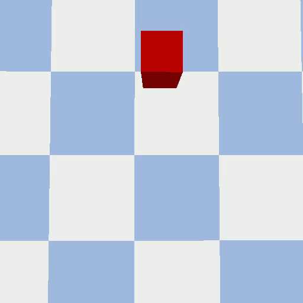

# ECE 276C Assignment 4: Visual Servoing

Python simulations of camera-based visual servoing in PyBullet. The project contains two scenarios: 
1. controlling a camera pose to center a target in the image
2. controlling a Franka Panda robot with an eye-in-hand camera.

## Demo

### Scenario 1: Camera visual servoing



### Scenario 2: Franka Panda robot with an eye-in-hand camera

#### Static target


#### Moving target


## Requirements

- Python 3
- PyBullet, NumPy, SciPy, OpenCV, and Hydra

Install the dependencies from the project root:

```bash
python -m pip install numpy scipy opencv-python hydra-core pybullet
```

## Run

The scripts import modules from `src`, so add that directory to `PYTHONPATH` before running them.

### Windows PowerShell

```powershell
$env:PYTHONPATH = "$PWD\src"
python scripts/scenario1.py
python scripts/scenario2.py
```

### macOS / Linux

```bash
PYTHONPATH=src python scripts/scenario1.py
PYTHONPATH=src python scripts/scenario2.py
```

Hydra command-line overrides can change configuration values. For example, run scenario 2 with a moving target:

```bash
PYTHONPATH=src python scripts/scenario2.py object.is_moving=true
```

In PowerShell, use the same Python command after setting `$env:PYTHONPATH` as shown above.

## Scenarios

### Scenario 1: Camera visual servoing

`scripts/scenario1.py` simulates image-based visual servoing. The controller uses the target's image position and depth to update the camera pose over 200 iterations, moving the target toward the image center.

Output: `output/scenario1.mp4`

### Scenario 2: Eye-in-hand robot camera

`scripts/scenario2.py` runs visual servoing with a camera mounted on a Franka Panda end effector. A separate fixed workspace camera is used only to provide context in the recording; it is not controlled by the servoing loop. The saved video places the robot camera view and workspace view side by side. Set `object.is_moving=true` to use the moving target trajectory.

Output: `output/scenario2/static.mp4` or `output/scenario2/moving.mp4`, depending on the target configuration.

## Project layout

```text
config/                 Hydra configuration files
scripts/scenario1.py    Camera visual servoing simulation
scripts/scenario2.py    Eye-in-hand robot simulation
scripts/init.py         PyBullet scene initialization
src/Camera.py           Camera model and image projection helpers
src/Object.py           Target object and motion trajectory
src/eye_in_hand_robot.py Franka Panda and mounted camera model
src/controller/         Camera-based visual servoing controllers
```

Scenario settings are in `config/scenario1.yaml` and `config/scenario2.yaml`; shared camera and target settings are in `config/camera.yaml` and `config/object.yaml`.
