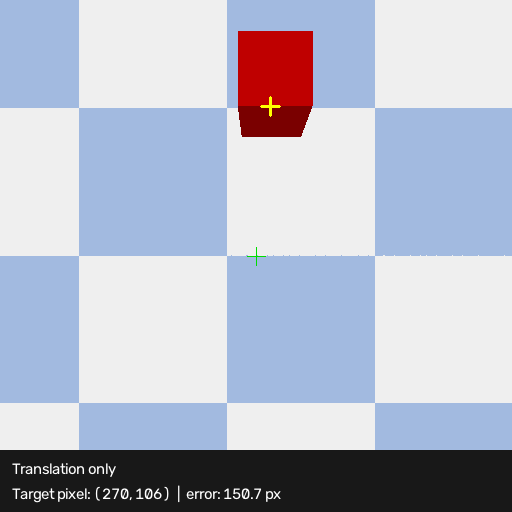
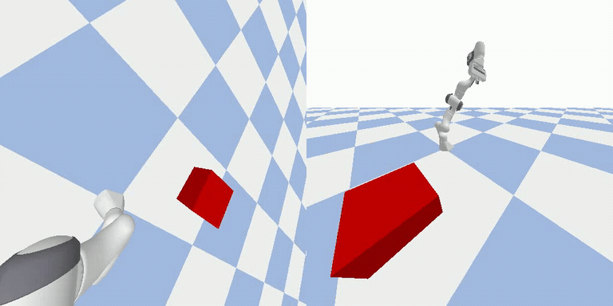
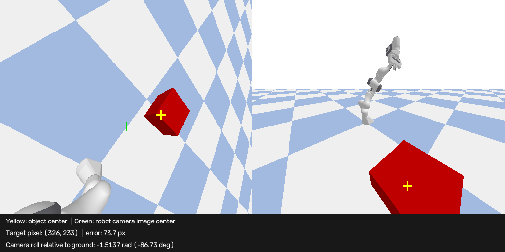

# ECE 276C Assignment 4: Visual Servoing

Python simulations of camera-based visual servoing in PyBullet. The project contains two scenarios: 
1. controlling a camera pose to center a target in the image
2. controlling a Franka Panda robot with an eye-in-hand camera.

## Demo

### Scenario 1: Camera visual servoing

#### Q2: Three camera control modes

<table>
  <tr>
    <th>Translation only</th>
    <th>Rotation only</th>
    <th>Translation + rotation</th>
  </tr>
  <tr>
    <td></td>
    <td></td>
    <td></td>
  </tr>
</table>

### Scenario 2: Franka Panda robot with an eye-in-hand camera

#### Static target


#### Moving target



#### Zero-roll control



## Requirements

- Python 3
- PyBullet, NumPy, SciPy, OpenCV, Hydra, and Pillow

Install the dependencies from the project root:

```bash
python -m pip install numpy scipy opencv-python hydra-core pybullet pillow
```

## Run

The scripts import modules from `src`, so add that directory to `PYTHONPATH` before running them.

### Windows PowerShell

```powershell
$env:PYTHONPATH = "$PWD\src"
python scripts/scenario1/Q1.py
python scripts/scenario1/Q2.py
python scripts/scenario2/tracking.py
python scripts/scenario2/0_roll.py
```

### macOS / Linux

```bash
PYTHONPATH=src python scripts/scenario1/Q1.py
PYTHONPATH=src python scripts/scenario1/Q2.py
PYTHONPATH=src python scripts/scenario2/tracking.py
PYTHONPATH=src python scripts/scenario2/0_roll.py
```

Hydra command-line overrides can change configuration values. For example, run scenario 2 with a moving target:

```bash
PYTHONPATH=src python scripts/scenario2/tracking.py object.is_moving=true
```

In PowerShell, use the same Python command after setting `$env:PYTHONPATH` as shown above.

## Scenarios

### Scenario 1: Camera visual servoing

`scripts/scenario1/Q1.py` checks the analytical image Jacobian against measured image motion and saves `output/scenario1/Q1.gif`. `scripts/scenario1/Q2.py` generates separate translation-only, rotation-only, and combined-control animations under `output/scenario1/Q2/`.

### Scenario 2: Eye-in-hand robot camera

`CameraController.control()` returns the desired camera twist in camera coordinates; `RobotController` converts it to world coordinates before solving with the robot Jacobian. `scripts/scenario2/tracking.py` runs this image-tracking controller and saves `output/scenario2/new.gif`. `scripts/scenario2/0_roll.py` uses `RobotNullController` to add a ground-relative camera-roll objective in the image-tracking null space and saves its annotated result to `output/scenario2/0roll.gif`. Static- and moving-target examples are also shown above.

## Project layout

```text
config/                 Hydra configuration files
scripts/scenario1/Q1.py Image Jacobian verification animation
scripts/scenario1/Q2.py Camera translation/rotation control animations
scripts/scenario2/tracking.py Standard eye-in-hand image tracking
scripts/scenario2/0_roll.py   Eye-in-hand tracking with null-space roll control
scripts/init.py         PyBullet scene initialization
src/Camera.py           Camera model and image projection helpers
src/Object.py           Target object and motion trajectory
src/eye_in_hand_robot.py Franka Panda and mounted camera model
src/controller/         Camera-based visual servoing controllers
```

Scenario settings are in `config/scenario1.yaml` and `config/scenario2.yaml`; shared camera and target settings are in `config/camera.yaml` and `config/object.yaml`.
