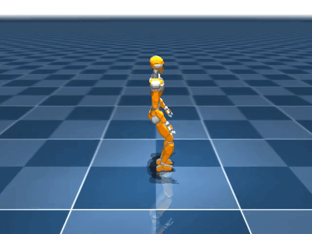

# Learning Humanoid Walking

Train bipedal walking policies for the JVRC humanoid in MuJoCo with PPO.

The simulator runs at 1 kHz and the policy at 40 Hz. The policy outputs target leg joint angles; a PD controller converts them to torques for MuJoCo `<motor>` actuators. Rewards use phase clocks to encourage alternating swing and stance.

Note: This repository is a **personal refactor / re-implementation** of
[rohanpsingh/LearningHumanoidWalking](https://github.com/rohanpsingh/LearningHumanoidWalking)(BSD-2-Clause). 

## Features

- Flat-ground walking for JVRC (legs-only model)
- PPO with a Gaussian actor and value critic
- Phase-clock rewards for foot force / velocity

## Demo



## Requirements

- Python 3.10
- CUDA optional (PyTorch wheel in requirements targets cu118)
- MuJoCo 3.x

## Installation

```bash
conda create -n LHW python=3.10
conda activate LHW
pip install -r Install/requirements.txt
```

See [`Install/requirements.txt`](Install/requirements.txt) for pinned packages (`mujoco`, `dm_control`, `torch`, `omegaconf`, `scipy`, `transforms3d`, `tensorboard`, etc.).

### Path setup

[`src/Pathes.py`](src/Pathes.py) hardcodes the workspace root. Change it to your clone:

```python
wsf = Path(r"E:\ProjectLocal\Robotics\Learning_Humanoid_Walking")  # Windows
# or
wsf = Path("/your/path/Learning_Humanoid_Walking")                 # Linux
```

Add `src` to `PYTHONPATH` when running scripts (already set in the VS Code launch config):

```bash
# Windows PowerShell
$env:PYTHONPATH = "E:\ProjectLocal\Robotics\Learning_Humanoid_Walking\src"

# Linux / macOS
export PYTHONPATH=/your/path/Learning_Humanoid_Walking/src
```

### Robot assets

Place the JVRC MuJoCo description at:

```text
assets/jvrc_mj_description/xml/scene.xml
```

Export a walking-oriented MJCF (legs only, simplified collisions) before training:

```bash
python scripts/gen_xml/jvrc.py
```

Output defaults to `tmp/mjcf-export/jvrc_walk/jvrc.xml`.

## Quick start

### Train (recommended)

```bash
python scripts/train1.py
```

Uses [`Config/Task/walk.yaml`](Config/Task/walk.yaml) with the `JvrcLeg` + `Walking` stack.

### Train (legacy)

```bash
python scripts/train.py
```

Uses [`Config/walk.yaml`](Config/walk.yaml) and the `jvrc_walk` environment.

### Evaluate / record video

```bash
python scripts/eval.py --path tmp/logs/actor.pt --ep_len 10
```

Loads the matching `critic*.pt`, opens a MuJoCo viewer, and writes an mp4.


## Repository layout

```text
Learning_Humanoid_Walking/
├── Config/                 # OmegaConf configs
│   ├── Task/walk.yaml      # train1
│   ├── walk.yaml           # train (legacy)
│   └── jvrc/               # PD gains, nominal pose, etc.
├── Install/                # dependencies
├── assets/                 # JVRC MJCF / meshes (provide locally)
├── scripts/
│   ├── train1.py           # main training entry
│   ├── train.py            # legacy training entry
│   ├── eval.py             # evaluation and recording
│   └── gen_xml/            # MJCF simplification / export
├── src/
│   ├── env/                # JvrcLeg, Walking, phase clock
│   ├── envs/               # jvrc_walk (legacy env)
│   ├── RL/                 # PPO, sampling, buffers
│   ├── network/            # Actor / Critic MLPs
│   ├── robots/             # RobotInterface, PD, contacts
│   ├── tasks/              # WalkingTask / rewards
│   └── Pathes.py           # global paths
└── tmp/                    # exported XML, logs
```

## Configuration

From `Config/Task/walk.yaml`:

| Field | Meaning |
|-------|---------|
| `dt.sim` / `dt.ctrl` | Simulation / control timestep (e.g. 0.001 / 0.025) |
| `phase.swing` / `stance` | Swing / double-stance duration (seconds) |
| `goal_height_ref` | Desired pelvis height |
| `goal_speed_ref` | Reference forward speed (may be randomized on reset) |
| `rl.network` | Actor/critic widths, action noise, etc. |
| `rl.train` | Learning rate, epochs, clip, eval frequency, etc. |

Robot PD gains and half-sitting nominal pose live in `Config/jvrc/leg.yaml`.

## Method sketch

1. **Model reduction** — From the full JVRC description, drop waist/head/arm joints, freeze arm pose, thin collisions, and use box foot geoms.
2. **Control** — Policy outputs joint-angle offsets around the half-sitting pose → smoothing → PD → `data.ctrl` (joint torques).
3. **Observation** — Pelvis roll/pitch, angular velocity, 12 leg joint positions/velocities, phase clock, goal speed.
4. **Reward** — Foot force/velocity phase clocks, orientation/height/forward-speed terms, torque and action-smoothness penalties.
5. **Termination** — Pelvis too low/high, or self-collision.

## Troubleshooting

**Sampling is extremely slow**  
Convert PD gains with `np.asarray(...)` before the control loop. Do not multiply OmegaConf `ListConfig` values with NumPy arrays every sim substep.

**Missing model or config**  
Check `Pathes.py` (`wsf`), `assets/jvrc_mj_description`, and `tmp/mjcf-export/.../jvrc.xml`.

**Inplace autograd error during PPO updates**  
Compute advantages under `torch.no_grad()` so they do not retain a graph into the critic after `optimizer.step()`.

## Citation

Please cite the upstream work if you build on this repository:

```bibtex
@inproceedings{singh2024robust,
  title={Robust Humanoid Walking on Compliant and Uneven Terrain with Deep Reinforcement Learning},
  author={Singh, Rohan P and Morisawa, Mitsuharu and Benallegue, Mehdi and Xie, Zhaoming and Kanehiro, Fumio},
  booktitle={2024 IEEE-RAS 23rd International Conference on Humanoid Robots (Humanoids)},
  pages={497--504},
  year={2024},
  organization={IEEE}
}

@article{xie2023learning,
  title={Learning bipedal walking for humanoids with current feedback},
  author={Singh, Rohan Pratap and Xie, Zhaoming and Gergondet, Pierre and Kanehiro, Fumio},
  journal={IEEE Access},
  volume={11},
  pages={82013--82023},
  year={2023},
  publisher={IEEE}
}

@inproceedings{singh2022learning,
  title={Learning Bipedal Walking On Planned Footsteps For Humanoid Robots},
  author={Singh, Rohan P and Benallegue, Mehdi and Morisawa, Mitsuharu and Cisneros, Rafael and Kanehiro, Fumio},
  booktitle={2022 IEEE-RAS 21st International Conference on Humanoid Robots (Humanoids)},
  pages={686--693},
  year={2022},
  organization={IEEE}
}
```

Phase-clock rewards and related ideas also draw from the OSU DRL Cassie line of work (see credits in the [upstream README](https://github.com/rohanpsingh/LearningHumanoidWalking)).

## License

Upstream code is released under the **BSD 2-Clause** license
([rohanpsingh/LearningHumanoidWalking](https://github.com/rohanpsingh/LearningHumanoidWalking)).
This refactor should retain that notice for derived portions. Robot mesh / MJCF assets under `assets/` follow their own licenses.
